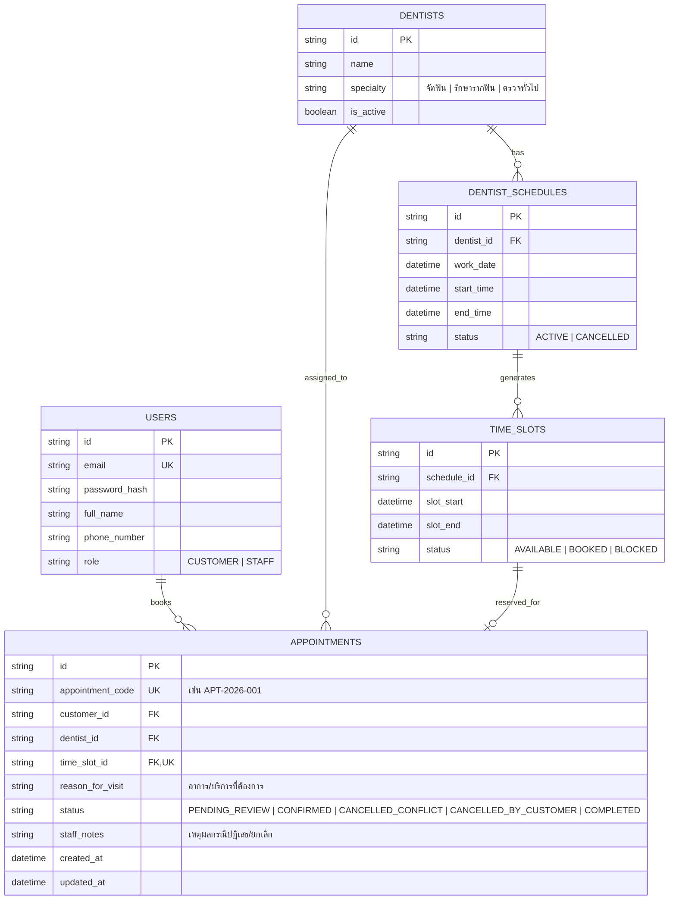
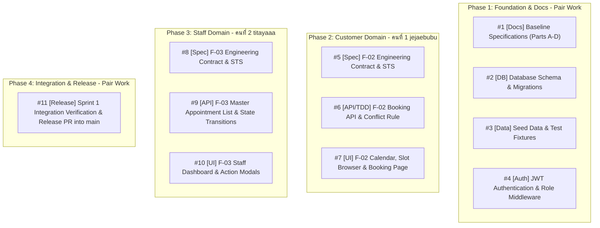

# SmileSync: Dental Clinic Appointment & Scheduling System
## Sprint 1 Master Specification & Engineering Baseline (Deliverable 1)

> **เอกสารข้อกำหนดทางวิศวกรรมฉบับสมบูรณ์ (Single Source of Truth - 11 Issues Complete Edition)**  
> วิชา: CPE 334 Introduction to Software Engineering (Semester 1/2026)  
> ทีมผู้พัฒนา: `titayaaa` (ฑิตญา ผ่องสกุล) & `jejaebubu` (ภัทรวดี แสน...)  
> GitHub Repository: https://github.com/titayaaa/dental-appointment-system  
> Branch หลัก: `main` (Production Release) | `staging` (Sprint Integration)

---

## 1. บริบทและขอบเขตของระบบ (Context & Scope)

* **ชื่อระบบ:** **SmileSync – ระบบจัดตารางเวลาและนัดหมายคลินิกทันตกรรม (Dental Clinic Appointment & Scheduling System)**
* **ปัญหาของคลินิก (Problem Statement):**  
  ผู้ป่วยไม่ทราบล่วงหน้าว่าทันตแพทย์เฉพาะทางเข้าตรวจวันไหนบ้าง ทำให้เสียเวลาโทรสอบถาม ในขณะที่คลินิกประสบปัญหาการนัดหมายเวลาชนกัน (Double booking) และไม่มีระบบติดตามสถานะคำขอนัดหมายแบบเป็นขั้นตอน
* **ขอบเขตที่ทำใน Sprint 1 (In Scope):**
  1. ระบบตารางเวรทันตแพทย์รายเดือน (Dentist Monthly Duty Roster)
  2. การสร้างและจัดการช่วงเวลานัดหมาย (Time Slot Management)
  3. วงจรการขอนัดหมาย ตรวจสอบ และติดตามสถานะ (Appointment Lifecycle & Status Tracking)
  4. การควบคุมสิทธิ์ (Role-based Access Control: `CUSTOMER` vs `STAFF`)
  5. กฎป้องกันการจองเวลาชนกัน (Conflict & Concurrency Protection)
  6. การทดสอบอัตโนมัติ (Automated Tests: Unit, Integration, TDD)
* **ขอบเขตที่ไม่ทำใน Sprint 1 (Explicit Exclusions):**
  * ไม่มีระบบชำระเงินออนไลน์ (ชำระที่คลินิกในวันนัดจริง)
  * ไม่มีการส่ง SMS/Email จริง (แจ้งเตือนและอัปเดตสถานะผ่านหน้าเว็บ)
  * ไม่มีระบบลืมรหัสผ่าน (ใช้บัญชีทดสอบที่ Seed ไว้ล่วงหน้า)

---

## 2. โมเดลข้อมูลและสกีมาฐานข้อมูล (Data Model & Prisma Schema)

### 2.1 ไดอะแกรมความสัมพันธ์ (ERD)



### 2.2 โค้ด Prisma Schema สำหรับใช้งานจริง (`prisma/schema.prisma`)

```prisma
datasource db {
  provider = "postgresql"
  url      = env("DATABASE_URL")
}

generator client {
  provider = "prisma-client-js"
}

enum Role {
  CUSTOMER
  STAFF
}

enum ScheduleStatus {
  ACTIVE
  CANCELLED
}

enum SlotStatus {
  AVAILABLE
  BOOKED
  BLOCKED
}

enum AppointmentStatus {
  PENDING_REVIEW
  CONFIRMED
  CANCELLED_CONFLICT
  CANCELLED_BY_CUSTOMER
  COMPLETED
}

model User {
  id           String        @id @default(uuid())
  email        String        @unique
  passwordHash String
  fullName     String
  phoneNumber  String?
  role         Role          @default(CUSTOMER)
  createdAt    DateTime      @default(now())
  updatedAt    DateTime      @updatedAt
  appointments Appointment[]

  @@map("users")
}

model Dentist {
  id           String            @id @default(uuid())
  name         String
  specialty    String            // เช่น "ทันตกรรมทั่วไป", "จัดฟัน", "รักษารากฟัน"
  isActive     Boolean           @default(true)
  schedules    DentistSchedule[]
  appointments Appointment[]

  @@map("dentists")
}

model DentistSchedule {
  id        String         @id @default(uuid())
  dentistId String
  dentist   Dentist        @relation(fields: [dentistId], references: [id])
  workDate  DateTime
  startTime DateTime
  endTime   DateTime
  status    ScheduleStatus @default(ACTIVE)
  slots     TimeSlot[]
  createdAt DateTime       @default(now())

  @@map("dentist_schedules")
}

model TimeSlot {
  id          String           @id @default(uuid())
  scheduleId  String
  schedule    DentistSchedule  @relation(fields: [scheduleId], references: [id])
  slotStart   DateTime
  slotEnd     DateTime
  status      SlotStatus       @default(AVAILABLE)
  appointment Appointment?

  @@map("time_slots")
}

model Appointment {
  id              String            @id @default(uuid())
  appointmentCode String            @unique // เช่น "APT-2026-001"
  customerId      String
  customer        User              @relation(fields: [customerId], references: [id])
  dentistId       String
  dentist         Dentist           @relation(fields: [dentistId], references: [id])
  timeSlotId      String            @unique // DB Constraint: ป้องกันจอง Slot เดียวกันซ้ำเด็ดขาด
  timeSlot        TimeSlot          @relation(fields: [timeSlotId], references: [id])
  serviceType     String            // "ขูดหินปูน", "อุดฟัน", "ตรวจฟันประจำปี"
  reasonForVisit  String?
  status          AppointmentStatus @default(PENDING_REVIEW)
  staffNotes      String?
  createdAt       DateTime          @default(now())
  updatedAt       DateTime          @updatedAt

  @@map("appointments")
}
```

---

## 3. วงจรสถานะและกฎทางธุรกิจ (Business Rules & State Machine)

### 3.1 วงจรสถานะของใบนัดหมาย (Appointment Lifecycle)
1. `PENDING_REVIEW` (จองแล้ว / รอยืนยัน): Customer เพิ่งกดจองเข้ามา Slot จะถูกเปลี่ยนเป็น `BOOKED` ทันที
2. `CONFIRMED` (ยืนยันนัดหมาย): Staff ตรวจสอบความถูกต้องและกดยืนยันนัด
3. `CANCELLED_CONFLICT` (ยกเลิกเนื่องจากเวลาซ้อน/แพทย์ติดภารกิจ): Staff ปฏิเสธนัดหมาย พร้อมระบุเหตุผลใน `staffNotes`
4. `CANCELLED_BY_CUSTOMER` (ยกเลิกโดยคนไข้): Customer กดยกเลิกนัดของตนเอง
5. `COMPLETED` (ตรวจเสร็จสิ้น): หมอฟันหรือ Staff บันทึกหลังคนไข้เข้ารับบริการจริง

### 3.2 กฎเหล็กของระบบ (Core Business Rules)
* **BR-01 (No Double Booking):** Slot ที่มีสถานะ `BOOKED` หรือผูกกับนัดหมายที่ไม่ถูกยกเลิก จะไม่สามารถถูกจองซ้ำได้ (คืนค่า `409 Conflict`)
* **BR-02 (Future Slot Only):** Customer ไม่สามารถจอง Slot เวลาที่ผ่านพ้นไปแล้วในอดีตได้ (คืนค่า `400 Bad Request`)
* **BR-03 (Customer Active Booking Quota):** Customer 1 คน สามารถมีนัดหมายที่ค้างอยู่ในสถานะ `PENDING_REVIEW` หรือ `CONFIRMED` ได้**ไม่เกิน 2 รายการพร้อมกัน** เพื่อป้องกันการสแปมคิว
* **BR-04 (Customer Privacy):** Customer ดูได้เฉพาะรายการนัดหมายของตนเอง (`customerId == current_user.id`) หากพยายามเข้าถึงของคนอื่น ต้องส่ง `403 Forbidden`
* **BR-05 (Staff Authority):** มีเพียง User ที่มี Role `STAFF` เท่านั้นที่สามารถเพิ่ม/แก้ไขตารางเวรหมอ, เปลี่ยนสถานะเป็น `CONFIRMED` หรือ `CANCELLED_CONFLICT`, และดูรายการนัดหมายทั้งหมดของคลินิกได้
* **BR-06 (Slot Release on Cancellation):** เมื่องานนัดหมายถูกยกเลิก (ไม่ว่าจะโดย Customer หรือ Staff) Time Slot นั้นจะต้องถูกปลดล็อกกลับมาเป็น `AVAILABLE` ทันทีเพื่อให้ผู้อื่นจองต่อได้

---

## 4. ข้อตกลง API Endpoints & Response Format

### 4.1 รูปแบบ JSON มาตรฐาน
* **เมื่อสำเร็จ (HTTP 200 / 201):**
  ```json
  {
    "success": true,
    "data": { ... }
  }
  ```
* **เมื่อเกิดข้อผิดพลาด (HTTP 400, 401, 403, 404, 409):**
  ```json
  {
    "success": false,
    "error": "ข้อความอธิบายความผิดพลาด"
  }
  ```

### 4.2 ตารางสรุป API Endpoints ทั้งหมด

| หมวดหมู่ | Method | Path | Role ที่อนุญาต | หน้าที่ |
| :--- | :---: | :--- | :---: | :--- |
| **Auth** | `POST` | `/api/auth/login` | Public | ตรวจ email/password คืนค่า JWT Token |
| **Auth** | `GET` | `/api/auth/me` | Logged In | ตรวจสอบโปรไฟล์ของผู้ใช้ปัจจุบัน |
| **Dentist** | `GET` | `/api/dentists` | Logged In | ดูรายชื่อหมอฟันและความเชี่ยวชาญ |
| **Customer** | `GET` | `/api/schedules/monthly` | Logged In | ดูตารางเวรหมอประจำเดือน |
| **Customer** | `GET` | `/api/slots/available` | Logged In | ดึงเฉพาะ Slot ที่ว่าง (`AVAILABLE` และเวลาอนาคต) |
| **Customer** | `POST` | `/api/appointments` | `CUSTOMER` | จองคิวทำฟัน (เช็ก BR-01 ห้ามจองซ้ำ 409) |
| **Customer** | `GET` | `/api/my-appointments` | `CUSTOMER` | ดูรายการนัดของตัวเอง (เช็ก BR-04 Data Privacy) |
| **Customer** | `PATCH` | `/api/my-appointments/:id/cancel` | `CUSTOMER` | กดยกเลิกนัดหมายของตนเอง |
| **Staff** | `POST` | `/api/admin/schedules` | `STAFF` | สร้างตารางเวรหมอและแตก Time Slots |
| **Staff** | `GET` | `/api/admin/schedules` | `STAFF` | ดึงตารางเวรทั้งหมดของคลินิก |
| **Staff** | `GET` | `/api/admin/appointments` | `STAFF` | ดึงนัดหมายทั้งหมด กรองตามวันหรือสถานะได้ |
| **Staff** | `PATCH` | `/api/admin/appointments/:id/status` | `STAFF` | กด Confirm หรือ Reject พร้อมใส่เหตุผล |

---

## 5. การแบ่งงานและรายละเอียด 11 Issues สำหรับบอร์ด GitHub



---

### 📁 หมวดที่ 1: Foundation & Docs (ทำคู่กัน)

#### Issue #1: `[Docs] Baseline Engineering Specifications (Parts A–D)`
* **Assignee:** `Pair Work (titayaaa & jejaebubu)`
* **Labels:** `docs`, `sprint-1`
* **Objective:** จัดทำเอกสารวิศวกรรมภาพรวมทั้งระบบตามเกณฑ์ Deliverable 1
* **Scope & Deliverables:**
  * `docs/srs.md`: ปัญหาของคลินิก, ขอบเขต (In/Out of scope), Actors (`CUSTOMER`, `STAFF`), Functional Requirements (FR-01 ถึง FR-06), Business Rules (BR-01 ถึง BR-06), NFR (Security, Performance)
  * `docs/features.md`: สารบัญฟีเจอร์ทั้ง 3 Sprints (F-01 ถึง F-09)
  * `docs/traceability.md`: ตาราง Traceability Matrix เชื่อมโยง Requirement $\rightarrow$ Feature $\rightarrow$ Sprint $\rightarrow$ Test
  * `docs/system-sds.md`: Architecture Stack, ERD 5 โมเดล, Security Design, Role Matrix
  * `docs/sprints/plan.md`: แผนงาน 3 Sprints แสดงเป้าหมายและ dependencies
* **Definition of Done (DoD):** เอกสารครอบคลุมตาม Rubric Part A ถึง Part D ครบถ้วน

---

#### Issue #2: `[DB] Database Schema Design & Migrations`
* **Assignee:** `Pair Work (titayaaa & jejaebubu)`
* **Labels:** `db`, `setup`, `sprint-1`
* **Objective:** วางโครงสร้างฐานข้อมูล PostgreSQL และสร้างตารางด้วย Prisma
* **Scope & Deliverables:**
  * เขียนไฟล์ `prisma/schema.prisma` ครบ 5 โมเดล: `User`, `Dentist`, `DentistSchedule`, `TimeSlot`, `Appointment`
  * กำหนด Constraints: `timeSlotId` ต้องเป็น **Unique Constraint** ในตาราง `Appointment`
  * รันคำสั่ง `npx prisma migrate dev --name init_smile_sync_schema`
* **Definition of Done (DoD):** รัน Migration สำเร็จ ตารางและ Foreign Key ทุกตัวถูกสร้างใน Database จริง

---

#### Issue #3: `[Data] Reproducible Seed Data & Test Accounts`
* **Assignee:** `Pair Work (titayaaa & jejaebubu)`
* **Labels:** `db`, `seed`, `sprint-1`
* **Objective:** สร้างชุดข้อมูลจำลองสำหรับใช้ในการพัฒนาและการรัน Automated Tests
* **Scope & Deliverables:**
  * เขียนไฟล์ `prisma/seed.ts` สร้างข้อมูล:
    * บัญชี Staff: `staff@clinic.com` / `password123`
    * บัญชี Customer 1: `customer1@test.com` / `password123`
    * บัญชี Customer 2: `customer2@test.com` / `password123`
    * ข้อมูลทันตแพทย์ 2 ท่าน: ทพ.สมชาย (ทันตกรรมทั่วไป), ทพญ.สุดา (จัดฟัน)
    * ตารางเวรและ Time Slots จำลอง ที่มีทั้งสถานะ `AVAILABLE` และ `BOOKED`
* **Definition of Done (DoD):** รันคำสั่ง `npx prisma db seed` แล้วได้ข้อมูลจำลองครบถ้วนในฐานข้อมูล

---

#### Issue #4: `[Auth] JWT Authentication & Role-Based Middleware`
* **Assignee:** `Pair Work (titayaaa & jejaebubu)`
* **Labels:** `backend`, `auth`, `security`, `sprint-1`
* **Objective:** พัฒนาระบบยืนยันตัวตนด้วย JWT และ Middleware สกัดกั้นสิทธิ์ตาม Role
* **Scope & Deliverables:**
  * Endpoint `POST /api/auth/login`: ตรวจสอบ email/password (bcrypt) $\rightarrow$ คืน JWT Token และ Role
  * Endpoint `GET /api/auth/me`: คืนค่าโปรไฟล์ของผู้ใช้จาก Bearer Token
  * Middleware `requireAuth`: ดักจับ Token ถ้าไม่มีให้คืน `401 Unauthorized`
  * Middleware `requireRole(['STAFF'])`: ตรวจสอบ Role ถ้าไม่ใช่ Staff ให้คืน `403 Forbidden`
* **Definition of Done (DoD):** มี Automated Test ยืนยันว่ารหัสผ่านผิดติด 401 และล็อกอินสำเร็จได้รับ Token ถูกต้อง

---

### 👤 หมวดที่ 2: Customer Domain (คนที่ 1 เป็นเจ้าของ: jejaebubu)

#### Issue #5: `[Spec] F-02 Engineering Contract & Software Test Specification (STS)`
* **Assignee:** `jejaebubu`
* **Labels:** `customer`, `contracts`, `sprint-1`
* **Objective:** จัดทำสัญญาทางวิศวกรรมของฟีเจอร์การจอง และนิยามแผนการทดสอบก่อนลงมือเขียนโค้ด (Pre-implementation contract)
* **Scope & Deliverables:**
  * สร้างไฟล์ `docs/sprints/sprint-1/feature-f02.md`: รายละเอียด UI behavior, API methods/payloads, Data flow
  * สร้างไฟล์ `docs/sprints/sprint-1/sts-f02.md`: นิยาม Acceptance Criteria (`AC-01`, `AC-02`, `AC-03`) และ Test Cases (`TEST-01`, `TEST-02`, `TEST-03`)
  * กำหนด Definition of Done (DoD) ของฟีเจอร์การจอง
* **Definition of Done (DoD):** เอกสารสัญญาถูก Commit ขึ้น Git ก่อนที่จะเริ่มการเขียนโค้ด Feature F-02

---

#### Issue #6: `[API/TDD] F-02 Booking API & Double-Booking Concurrency Protection`
* **Assignee:** `jejaebubu`
* **Labels:** `customer`, `backend`, `tdd`, `sprint-1`
* **Objective:** พัฒนา Backend API สำหรับการจองคิว พร้อมระบบป้องกันการจองซ้ำ และใช้แนวคิด TDD
* **Scope & Deliverables:**
  * Endpoint `GET /api/slots/available`: ดึงเฉพาะ Slot ที่ว่างของหมอฟันและวันที่เลือก
  * Endpoint `POST /api/appointments`: รับ `{ dentistId, timeSlotId, serviceType, reasonForVisit }`
    * ตรวจสอบ BR-02 (ห้ามจองเวลาในอดีต)
    * ตรวจสอบ BR-03 (Customer คนเดิมค้างนัด active เกิน 2 นัดหรือไม่)
    * **กฎเหล็ก BR-01:** ตรวจสอบว่า Slot ว่างจริง ถ้าไม่ว่างให้ตอบ `409 Conflict`
    * บันทึก Transaction: สร้าง Appointment สถานะ `PENDING_REVIEW` + อัปเดต Slot เป็น `BOOKED`
  * Endpoint `GET /api/my-appointments`: คืนเฉพาะนัดของ `current_user.id` (BR-04 Data Privacy)
  * Endpoint `PATCH /api/my-appointments/:id/cancel`: ยกเลิกนัดของตนเอง และปลดล็อก Slot คืนเป็น `AVAILABLE` (BR-06)
  * **TDD Showcase:** เขียนเทสต์ `TEST-02` (แย่งจอง Slot เดียวกันแล้วติด 409) เก็บหลักฐาน Test Fail ก่อนเขียนโค้ด และ Pass หลังเขียนเสร็จ
* **Definition of Done (DoD):** ผ่าน Automated Tests ทุกข้อ รวมทั้งเทสต์ 409 Conflict และ 403 Data Privacy

---

#### Issue #7: `[UI] F-02 Customer Calendar, Slot Browser & My Appointments View`
* **Assignee:** `jejaebubu`
* **Labels:** `customer`, `frontend`, `sprint-1`
* **Objective:** สร้างหน้าจอเว็บสำหรับคนไข้ในการค้นหารอบตรวจ จองคิว และดูใบนัดหมาย
* **Scope & Deliverables:**
  * หน้า Calendar / Schedule: ปฏิทินแสดงวันที่ทันตแพทย์แต่ละท่านเข้าตรวจ
  * หน้า Slot Browser: การ์ดแสดงรอบเวลาว่าง (เช่น 10:00 - 10:45) พร้อมปุ่ม "จองรอบนี้"
  * Booking Modal: Dropdown เลือกประเภทบริการ (ขูดหินปูน, อุดฟัน) + Textarea ระบุอาการ + ปุ่มยืนยัน
  * หน้า "My Appointments": ตารางนัดหมายของฉัน แสดง Badge สถานะ (`PENDING_REVIEW`, `CONFIRMED`, `CANCELLED`) และปุ่มกดยกเลิก
  * จัดการ Error Alert เมื่อติด 409 Conflict (*"ขออภัย รอบเวลานี้เพิ่งมีผู้จองไป กรุณาเลือกรอบอื่น"*)
* **Definition of Done (DoD):** คนไข้สามารถเปิดหน้าเว็บ ทำการจองคิวจริง และเห็นใบนัดขึ้นในหน้า My Appointments ได้สมบูรณ์

---

### 👨‍⚕️ หมวดที่ 3: Staff Domain (คนที่ 2 เป็นเจ้าของ: titayaaa)

#### Issue #8: `[Spec] F-03 Engineering Contract & Software Test Specification (STS)`
* **Assignee:** `titayaaa`
* **Labels:** `staff`, `contracts`, `sprint-1`
* **Objective:** จัดทำสัญญาทางวิศวกรรมของฟีเจอร์เจ้าหน้าที่ และแผนการทดสอบก่อนเริ่มเขียนโค้ด
* **Scope & Deliverables:**
  * สร้างไฟล์ `docs/sprints/sprint-1/feature-f03.md`: รายละเอียดหน้า Dashboard, API endpoints, State transitions
  * สร้างไฟล์ `docs/sprints/sprint-1/sts-f03.md`: นิยาม Acceptance Criteria (`AC-04`, `AC-05`, `AC-06`) และ Test Cases (`TEST-04`, `TEST-05`, `TEST-06`)
  * กำหนด Definition of Done (DoD) ของฟีเจอร์ฝั่ง Staff
* **Definition of Done (DoD):** เอกสารสัญญาถูก Commit ขึ้น Git ก่อนที่จะเริ่มการเขียนโค้ด Feature F-03

---

#### Issue #9: `[API] F-03 Master Appointment List & State Transition Management`
* **Assignee:** `titayaaa`
* **Labels:** `staff`, `backend`, `sprint-1`
* **Objective:** พัฒนา Backend API สำหรับ Staff ในการจัดการตารางเวรหมอ และอนุมัติ/ปฏิเสธนัดหมาย
* **Scope & Deliverables:**
  * Endpoint `POST /api/admin/schedules`: รับข้อมูลวันเวลาเข้าเวรหมอ และแตกสร้าง TimeSlots สถานะ `AVAILABLE`
  * Endpoint `GET /api/admin/schedules`: ดึงตารางเวรทั้งหมดของคลินิก
  * Endpoint `GET /api/admin/appointments`: ดึงรายการนัดหมายทั้งหมดในคลินิก (รองรับการกรองตามวันและสถานะ)
  * Endpoint `PATCH /api/admin/appointments/:id/status`:
    * รับ `{ status: "CONFIRMED" | "CANCELLED_CONFLICT", staffNotes: string }`
    * หากเปลี่ยนเป็น `CANCELLED_CONFLICT` ต้องปลดล็อก Slot นั้นกลับเป็น `AVAILABLE` ทันที (BR-06)
  * **Role Security Test:** เขียนเทสต์ `TEST-04` ตรวจสอบว่าถ้า Customer แอบยิง API นี้ ต้องถูกบล็อกด้วย `403 Forbidden`
* **Definition of Done (DoD):** Staff สามารถเรียก API อัปเดตสถานะนัดหมายได้จริง และมี Test สกัดกั้นสิทธิ์ผ่าน 100%

---

#### Issue #10: `[UI] F-03 Staff Master Dashboard & Action Modals`
* **Assignee:** `titayaaa`
* **Labels:** `staff`, `frontend`, `sprint-1`
* **Objective:** สร้างหน้าจอเว็บสำหรับเจ้าหน้าที่คลินิกในการสร้างรอบตรวจ และจัดการคิวนัดหมาย
* **Scope & Deliverables:**
  * หน้า Schedule Planner: ฟอร์มเลือกทันตแพทย์, วันที่ และเวลาเข้าเวร พร้อมปุ่ม "สร้างรอบตรวจ"
  * แดชบอร์ดรวมคิวนัดหมาย (Master Dashboard): ตารางแสดงนัดหมายทั้งหมด พร้อมตัวกรองสถานะ
  * Action Buttons: ปุ่มสีเขียว **"Confirm"** และปุ่มสีแดง **"Reject (Conflict)"**
  * Review Modal: เมื่อกด Reject จะมีกล่องให้ระบุ `staffNotes` (เช่น แพทย์ติดเคสผ่าตัดฉุกเฉิน) บันทึกส่งกลับให้คนไข้เห็น
* **Definition of Done (DoD):** Staff สามารถเปิดหน้าเว็บ กดสร้างรอบตรวจ และกดอนุมัติ/ปฏิเสธนัดหมายได้ผลลัพธ์ทันที

---

### 🚀 หมวดที่ 4: Integration & Release (ทำคู่กัน)

#### Issue #11: `[Release] Sprint 1 Verification, Test Report & Release PR into main`
* **Assignee:** `Pair Work (titayaaa & jejaebubu)`
* **Labels:** `release`, `git`, `documentation`, `sprint-1`
* **Objective:** รวมงานทั้งหมดเข้าสู่ `staging` ทำการ Cross-Review ผ่าน PR รัน Automated Tests ครบชุด และจัดทำเล่มรายงาน Deliverable 1 PDF
* **Scope & Deliverables:**
  * **Cross-Review Evidence:**
    * คนที่ 1 ส่ง PR ฝั่ง Customer เข้า `staging` $\rightarrow$ คนที่ 2 รีวิวและกด Approve
    * คนที่ 2 ส่ง PR ฝั่ง Staff เข้า `staging` $\rightarrow$ คนที่ 1 รีวิวและกด Approve
  * **Full-Suite Test Execution:** รันคำสั่งทดสอบทั้งหมด เก็บผลลัพธ์ Passed/Failed และ Test counts
  * **Deliverable 1 Report Compilation:**
    * รวบรวมเอกสาร Part A ถึง Part E
    * Part F: แนบรูปภาพหน้าจอโปรแกรม (Happy path, บล็อก 409, บล็อก 403), ผลรัน Test, ตาราง AC-to-Test, หลักฐาน PR Reviews บน GitHub และตาราง Contribution
  * เปิด Release PR จาก `staging` รวมเข้า `main` พร้อมติด Git Tag: `v0.1.0-sprint1`
  * Export ไฟล์ PDF ส่ง LEB2 ให้ทันกำหนด
* **Definition of Done (DoD):** โค้ดบน Branch `main` สมบูรณ์ รันได้จริง และไฟล์ PDF Deliverable 1 ส่งผ่านระบบ LEB2 เรียบร้อย
