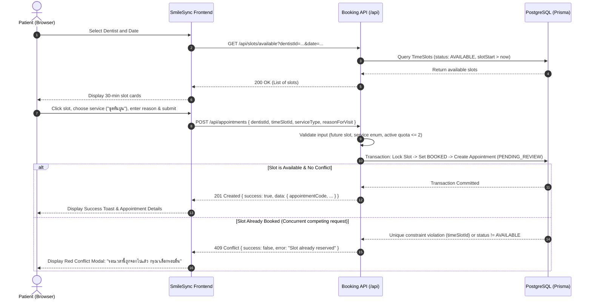

# Feature Engineering Contract: F-02 Patient Slot Discovery & Booking
## Sprint 1 Engineering Specification & Contract (Part E)

| Attribute | Specification Details |
| :--- | :--- |
| **Feature ID** | **F-02** |
| **Feature Name** | **Patient Slot Discovery & Booking (Vertical Slice)** |
| **Feature Owner** | `jejaebubu` (Customer Domain Lead) |
| **Target Sprint** | **Sprint 1** |
| **Linked Requirements** | `FR-03` (Available Slot Discovery), `FR-04` (Patient Booking), `BR-01` (Exclusive Slot / 409 Conflict), `BR-02` (Future Slots Only), `BR-03` (Patient Quota <= 2 Active), `NFR-02` (Concurrency & Consistency) |
| **Dependencies** | `F-01` (Authentication & JWT Verification), `F-03` (Dentist Schedule & Generated Slots) |

---

## 1. Feature Narrative & User Story

### 1.1 User Story
> **As a** registered clinic patient (`CUSTOMER`),  
> **I want to** browse dentists, view their real-time available time slots, and submit an appointment booking for a specific dental service,  
> **So that** I can secure dental care efficiently without double-booking conflicts or administrative delays.

### 1.2 User Journey Workflow


---

## 2. Layer-by-Layer Technical Specification

### 2.1 UI Layer Behavior & Interface States
* **Page Route:** `/booking`
* **Components:**
  1. **Dentist Filter Bar:** Dropdown showing all active dentists with their specialty (`ทพ.สมชาย - ทันตกรรมทั่วไป`, `ทพญ.สุดา - จัดฟัน`).
  2. **Calendar / Date Picker:** Restricts selection to today and future dates; past dates are disabled.
  3. **Slot Cards Grid:**
     - Displays 30-minute intervals (e.g. `09:00 - 09:30`, `10:00 - 10:30`).
     - Available slots are highlighted in green with a "จองเวลานี้ (Book Now)" button.
  4. **Booking Confirmation Modal:**
     - Displays summary: Dentist Name, Selected Date, Time Range.
     - Dropdown: `serviceType` (`ขูดหินปูน`, `อุดฟัน`, `ตรวจฟันประจำปี`, `ถอนฟัน`, `ปรึกษาจัดฟัน`, `อื่นๆ (ระบุในข้อมูลเพิ่มเติม)`).
     - Textarea: `reasonForVisit` (symptoms description or specifics if 'อื่นๆ' is chosen, max 500 characters).
     - Action buttons: "ยืนยันการจอง (Confirm)" and "ยกเลิก (Dismiss)".
* **Shared UI States:**
  - **Loading State:** Skeleton shimmer over slot grid while fetching.
  - **Empty State:** Alert banner stating: *"ไม่พบรอบตรวจที่ว่างในวันที่เลือก กรุณาเลือกวันอื่นหรือทันตแพทย์ท่านอื่น"*
  - **Error Toast (409 Conflict):** Pops up modal warning: *"ขออภัย รอบเวลานี้เพิ่งมีผู้จองไปเมื่อสักครู่ กรุณาเลือกรอบเวลาใหม่"* and automatically re-fetches the slot list.

### 2.2 API Layer Contracts

#### A. Query Available Slots
* **Endpoint:** `GET /api/slots/available`
* **Access Control:** Logged-in user (`CUSTOMER` or `STAFF`) with valid Bearer JWT.
* **Query Parameters:**
  - `dentistId` (string, UUID, required)
  - `date` (string, ISO-8601 date `YYYY-MM-DD`, required)
* **Success Response (HTTP 200 OK):**
  ```json
  {
    "success": true,
    "data": [
      {
        "id": "e6a0d2f0-7b3b-4e12-88f1-83d8bc671a10",
        "scheduleId": "c4d5e6f7-...",
        "slotStart": "2026-11-16T02:00:00.000Z",
        "slotEnd": "2026-11-16T02:30:00.000Z",
        "status": "AVAILABLE",
        "dentist": {
          "id": "a1b2c3d4-...",
          "name": "ทพ.สมชาย ใจดี",
          "specialty": "ทันตกรรมทั่วไป"
        }
      }
    ]
  }
  ```

#### B. Submit Appointment Booking
* **Endpoint:** `POST /api/appointments`
* **Access Control:** Restricted to `CUSTOMER` role only.
* **Request Headers:**
  - `Authorization: Bearer <jwt_token>`
  - `Content-Type: application/json`
* **Request Body:**
  ```json
  {
    "dentistId": "a1b2c3d4-...",
    "timeSlotId": "e6a0d2f0-7b3b-4e12-88f1-83d8bc671a10",
    "serviceType": "ขูดหินปูน",
    "reasonForVisit": "ตรวจสุขภาพฟันประจำปี และขูดหินปูน"
  }
  ```
* **Success Response (HTTP 201 Created):**
  ```json
  {
    "success": true,
    "data": {
      "id": "f8e7d6c5-...",
      "appointmentCode": "APT-202611-002",
      "customerId": "user-uuid",
      "dentistId": "a1b2c3d4-...",
      "timeSlotId": "e6a0d2f0-...",
      "serviceType": "ขูดหินปูน",
      "reasonForVisit": "ตรวจสุขภาพฟันประจำปี และขูดหินปูน",
      "status": "PENDING_REVIEW",
      "createdAt": "2026-11-15T05:10:00.000Z"
    }
  }
  ```
* **Error Responses:**
  - **HTTP 400 Bad Request:** Missing fields, invalid service type, or target slot time is in the past (`BR-02`).
    ```json
    { "success": false, "error": "Cannot reserve slots in the past." }
    ```
  - **HTTP 401 Unauthorized:** Missing or expired JWT token.
  - **HTTP 403 Forbidden:** Role is not `CUSTOMER`, or patient active booking quota exceeded (`BR-03`).
    ```json
    { "success": false, "error": "Booking limit reached: Max 2 active appointments allowed." }
    ```
  - **HTTP 409 Conflict:** The slot has already been reserved or booked (`BR-01`).
    ```json
    { "success": false, "error": "This time slot is no longer available. Please select another slot." }
    ```

### 2.3 Database & Concurrency Enforcement Layer
* **Transaction Strategy:** The booking operation is executed inside an atomic transaction:
  ```typescript
  return await prisma.$transaction(async (tx) => {
    // 1. Check slot availability with row lock
    const slot = await tx.timeSlot.findUnique({
      where: { id: timeSlotId },
    });
    if (!slot || slot.status !== 'AVAILABLE' || new Date(slot.slotStart) <= new Date()) {
      throw new ConflictError('Slot is no longer available.');
    }

    // 2. Transition slot status to BOOKED
    await tx.timeSlot.update({
      where: { id: timeSlotId },
      data: { status: 'BOOKED' },
    });

    // 3. Create appointment record
    const appointment = await tx.appointment.create({
      data: {
        appointmentCode: generateCode(),
        customerId: userId,
        dentistId,
        timeSlotId,
        serviceType,
        reasonForVisit,
        status: 'PENDING_REVIEW',
      },
    });

    return appointment;
  });
  ```
* **Database Constraint:** The unique index `time_slot_id_key` on `appointments` guarantees that even if concurrent requests pass application logic simultaneously, the PostgreSQL engine will reject the duplicate insert.

---

## 3. Acceptance Criteria (AC)

* **`AC-01 (Available Slots Query):`** When a patient queries `/api/slots/available` for a dentist and date, the response MUST include only slots with status `AVAILABLE` whose start time is strictly in the future.
* **`AC-02 (Happy Path Booking):`** Given an available future time slot and valid service type, submitting `/api/appointments` MUST return HTTP 201, persist the appointment in `PENDING_REVIEW` status, and atomically change the slot status to `BOOKED`.
* **`AC-03 (Double Booking Rejection - TDD Core):`** Given a slot that is already `BOOKED` or concurrently targeted by two patients, the second reservation request MUST be rejected with HTTP 409 Conflict, without creating a second appointment or corrupting slot state.
* **`AC-04 (Past Slot Boundary Validation):`** When a booking request specifies a slot whose `slotStart` is less than or equal to current server time, the request MUST be rejected with HTTP 400 Bad Request.
* **`AC-05 (Customer Active Booking Quota):`** When a patient who already has 2 active appointments (`PENDING_REVIEW` or `CONFIRMED`) attempts to book a 3rd appointment, the system MUST reject the request with HTTP 403 Forbidden.

---

## 4. Product Definition of Done (DoD) for F-02

1. **Pre-Implementation Specification:** This engineering contract and STS are committed to Git prior to feature code implementation.
2. **Implementation:** Backend endpoints (`GET /api/slots/available`, `POST /api/appointments`) and frontend UI components are fully implemented.
3. **Automated Verification:** All mapped automated tests (`TEST-CUST-01` to `TEST-CUST-04`, `TEST-TDD-01`) pass with 100% green status.
4. **TDD Evidence:** Red-to-Green execution logs demonstrating test failure before concurrency handling and passing afterward are recorded for `TEST-TDD-01`.
5. **Peer Review:** Code reviewed and approved by `titayaaa` with documented feedback on GitHub PR.
