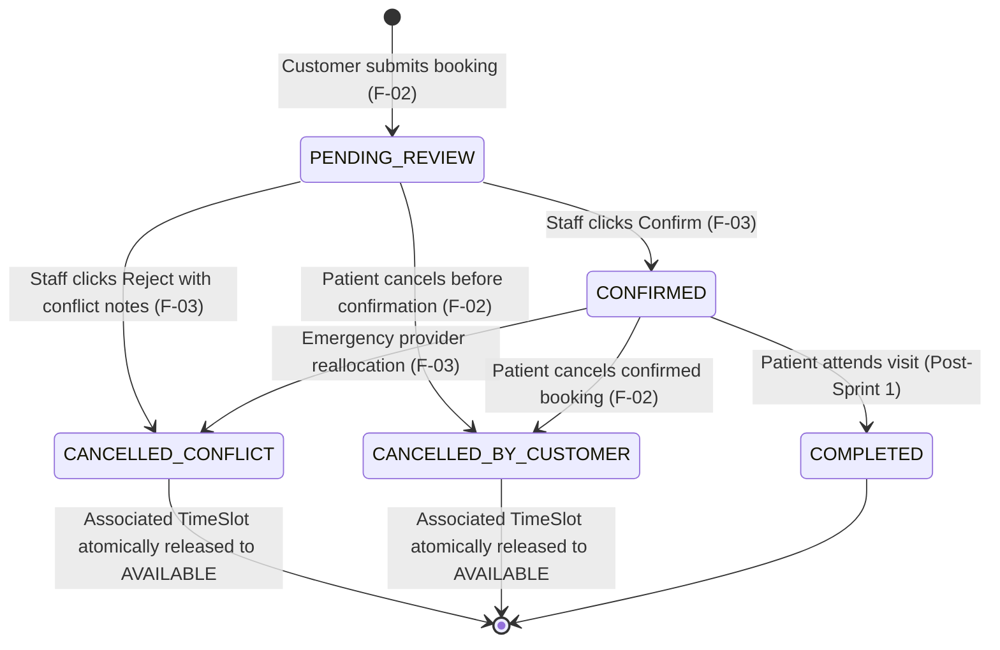

# Feature Engineering Contract: F-03 Staff Schedule Planner & Master Appointment Management
## Sprint 1 Engineering Specification & Contract (Part E - Showcase 2)

| Attribute | Specification Details |
| :--- | :--- |
| **Feature ID** | **F-03** |
| **Feature Name** | **Staff Schedule Planner, Master Appointment Review & State Transitions** |
| **Feature Owner** | `titayaaa` (Staff Domain Lead) |
| **Target Sprint** | **Sprint 1** |
| **Linked Requirements** | `FR-02` (Dentist Schedule & Slot Generation), `FR-05` (Staff Master Dashboard), `FR-06` (Appointment Lifecycle Management), `BR-05` (Staff-Only Authorization), `BR-06` (Conflict Cancellation & Slot Release), `NFR-01` (RBAC Security) |
| **Dependencies** | `F-01` (Authentication & Role Guards), `F-02` (Customer Booking & Appointments) |

---

## 1. Feature Narrative & User Stories

### 1.1 User Stories
> **As a** clinic receptionist / dental assistant (`STAFF`),  
> **I want to** register duty schedules for dentists with automated 30-minute time slot generation,  
> **So that** patients can immediately discover available booking intervals.

> **As a** clinic receptionist / dental assistant (`STAFF`),  
> **I want to** review all incoming patient appointment requests, filter by date and status, and confirm or cancel conflicting bookings with staff notes,  
> **So that** clinic operations remain organized and rejected slots are immediately recycled for other patients.

### 1.2 State Transition Lifecycle (BR-06)


---

## 2. Layer-by-Layer Technical Specification

### 2.1 UI Layer Behavior & Interface States
* **Page Routes / Views:**
  1. **Schedule Planner (`/staff/schedules`):**
     - Form: Dentist selection dropdown, Work date picker (minimum tomorrow), Shift Start Time (e.g. `09:00`), Shift End Time (e.g. `12:00` or `17:00`).
     - Action: "สร้างรอบตรวจทันตแพทย์ (Generate 30-min Slots)" button.
     - On submission: Automatically slices shift into discrete 30-minute intervals and persists as `AVAILABLE` time slots.
     - Schedule List: Displays existing duty rosters with dentist name, work date, shift hours, and total generated slots.
  2. **Master Appointments Dashboard (`/staff/appointments`):**
     - Filter Bar: Status filter pills (`ALL`, `PENDING_REVIEW`, `CONFIRMED`, `CANCELLED_CONFLICT`, `CANCELLED_BY_CUSTOMER`).
     - Date filter picker (optional/all dates).
     - Appointment Master Table / Cards:
       - Displays: Appointment Code, Patient Name, Phone, Dentist Name, Service Type, Slot Date & Time, Reason for Visit, Status Badge.
     - Action Buttons (for `PENDING_REVIEW` & `CONFIRMED` rows):
       - **"Confirm (อนุมัติ/ยืนยัน)":** Green button transitioning status to `CONFIRMED`.
       - **"Reject Conflict (ปฏิเสธ/เวลาชนกัน)":** Red button opening Reject Modal.
  3. **Reject Action Modal:**
     - Header: "ระบุเหตุผลการปฏิเสธ / ยกเลิกเนื่องจากเวลาชนกัน"
     - Textarea: `staffNotes` (e.g. "ทันตแพทย์ติดเคสผ่าตัดฉุกเฉิน กรุณาเลือกรอบอื่น", required, min 5 chars).
     - Action buttons: "ยืนยันการปฏิเสธ (Submit Reject)" and "ยกเลิก (Dismiss)".
     - Consequence: Sets status to `CANCELLED_CONFLICT`, saves `staffNotes`, and unlocks slot back to `AVAILABLE`.

### 2.2 API Layer Contracts

#### A. Create Dentist Duty Schedule & Discrete Slots
* **Endpoint:** `POST /api/admin/schedules`
* **Access Control:** Restricted to `STAFF` role only (`requireRole([Role.STAFF])`).
* **Request Body:**
  ```json
  {
    "dentistId": "dentist-somchai",
    "workDate": "2026-11-25",
    "startTime": "09:00",
    "endTime": "12:00"
  }
  ```
* **Success Response (HTTP 201 Created):**
  ```json
  {
    "success": true,
    "data": {
      "schedule": {
        "id": "sched-uuid-...",
        "dentistId": "dentist-somchai",
        "workDate": "2026-11-25T00:00:00.000Z",
        "startTime": "2026-11-25T09:00:00.000Z",
        "endTime": "2026-11-25T12:00:00.000Z",
        "status": "ACTIVE"
      },
      "generatedSlotsCount": 6
    }
  }
  ```
* **Error Responses:**
  - `400 Bad Request`: Missing fields, invalid time range (`endTime <= startTime`), past date.
  - `401 Unauthorized`: Missing or invalid token.
  - `403 Forbidden`: Role is `CUSTOMER`.

#### B. Query Master Schedules
* **Endpoint:** `GET /api/admin/schedules`
* **Access Control:** `STAFF` role only.
* **Success Response (HTTP 200 OK):** Array of all schedules with associated dentist info and slot counts.

#### C. Query Master Appointments List
* **Endpoint:** `GET /api/admin/appointments`
* **Access Control:** `STAFF` role only.
* **Query Parameters:**
  - `status` (optional: `PENDING_REVIEW`, `CONFIRMED`, `CANCELLED_CONFLICT`, `ALL`)
  - `date` (optional: `YYYY-MM-DD`)
* **Success Response (HTTP 200 OK):** Array of appointments with patient details (`fullName`, `phoneNumber`, `email`), dentist details, and slot timing.

#### D. Update Appointment Status & State Transitions
* **Endpoint:** `PATCH /api/admin/appointments/:id/status`
* **Access Control:** `STAFF` role only.
* **Request Body:**
  ```json
  {
    "status": "CONFIRMED" | "CANCELLED_CONFLICT",
    "staffNotes": "ทันตแพทย์ติดเคสฉุกเฉิน กรุณาจองรอบใหม่"
  }
  ```
* **Success Response (HTTP 200 OK):**
  ```json
  {
    "success": true,
    "data": {
      "id": "apt-uuid-...",
      "status": "CANCELLED_CONFLICT",
      "staffNotes": "ทันตแพทย์ติดเคสฉุกเฉิน กรุณาจองรอบใหม่",
      "slotStatus": "AVAILABLE"
    }
  }
  ```

---

## 3. Concurrency & Business Rules Enforcement
1. **`BR-05 (Staff RBAC Security):`** Any invocation of `/api/admin/*` by non-staff accounts (including patients with `Role.CUSTOMER`) MUST be intercepted by `requireRole([Role.STAFF])` and rejected with `HTTP 403 Forbidden`.
2. **`BR-06 (Conflict Slot Recycle):`** When status transitions to `CANCELLED_CONFLICT`, the database transaction MUST atomically update `Appointment.status = CANCELLED_CONFLICT` AND `TimeSlot.status = AVAILABLE`.

### 3.1 Architecture Note & Sprint 2 Evolution (Unique Constraint on Slot Recycle)
* **Current Sprint 1 Architecture:** In the current schema, `Appointment.timeSlotId` enforces `@unique @map("time_slot_id")` at the engine level to definitively eliminate concurrent double-booking. When a slot is recycled back to `AVAILABLE` upon `CANCELLED_CONFLICT`, the slot becomes bookable again.
* **Sprint 2 Roadmap:** To support full historical audit trails if a single slot is booked and cancelled multiple times across the clinic history, the schema will be evolved from an unconditional `@unique` constraint to a PostgreSQL partial unique index: `CREATE UNIQUE INDEX active_slot_idx ON appointments (time_slot_id) WHERE status IN ('PENDING_REVIEW', 'CONFIRMED');` or generate regenerated slot records.

---

## 4. Definition of Done (DoD) for F-03
1. **Specification Pre-requisite:** Engineering contract and STS committed to Git before feature code.
2. **API & Test Implementation:** Admin endpoints fully implemented with 100% green automated integration tests.
3. **Staff Dashboard UI:** Staff UI fully interactive on localhost with schedule generation and status transitions.
4. **Peer Review:** Code reviewed and approved by `jejaebubu` on GitHub PR.
